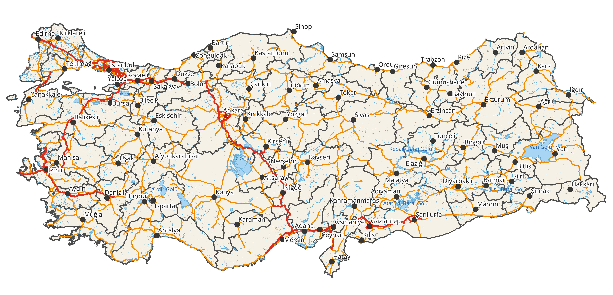
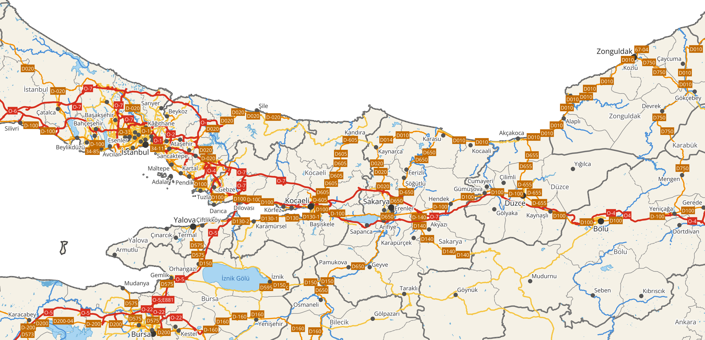
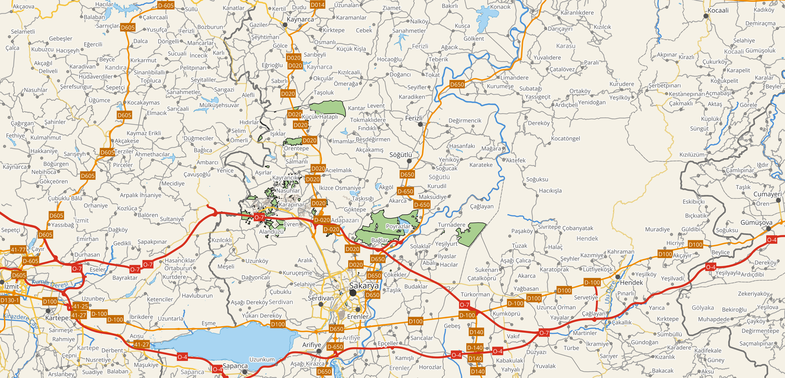
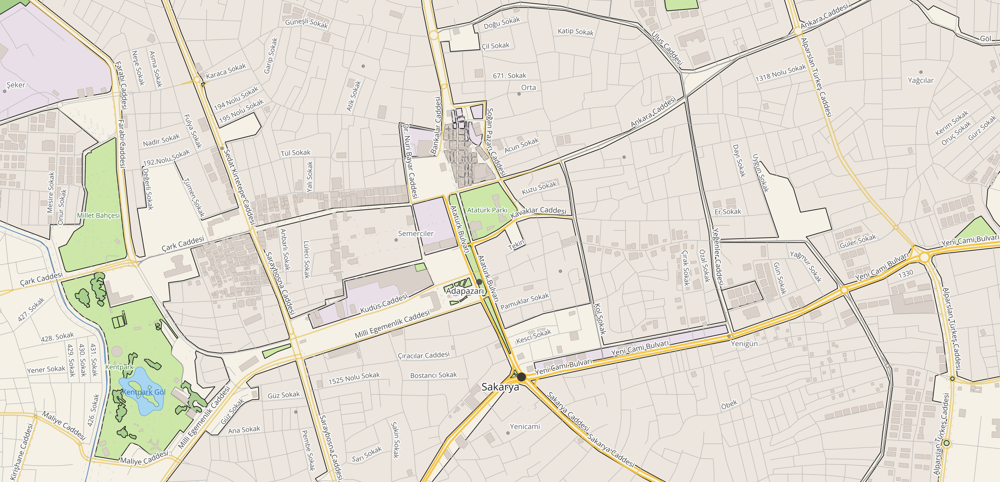

# QGIS ile Türkiye Kartografik Harita Tasarımı

Sakarya Üniversitesi, Coğrafi Bilgi Sistemleri dersi **Ödev 2**. Türkiye'nin dört ölçek düzeyinde görüntülenebilen, kartografik kurallara uygun, çok katmanlı bir QGIS haritası.

**Hazırlayan:** Numan AK, Bilgisayar Mühendisliği, Sakarya Üniversitesi



## Özellikler

- **8 katman:** il ve ilçe sınırları, yollar, yerleşimler, akarsular, göller, arazi kullanımı, binalar
- **Ölçeğe bağlı görünürlük:** Her katman ve alt sınıf yalnızca uygun yakınlaşma aralığında çizilir
- **Kural tabanlı semboloji:** 7 yol sınıfı (sembol düzeyleriyle), 5 yerleşim sınıfı, 5 arazi kullanımı sınıfı
- **Kural tabanlı etiketleme:** Önceliklendirme, çakışma kontrolü ("Never Overlap"), yol numarası levhaları, kavisli sokak ve nehir adları
- **Projeksiyon:** WGS 84 / UTM Zone 36N (EPSG:32636)

## Ölçek düzeyleri

| Düzey | Ölçek | Görünen ana detay |
| --- | --- | --- |
| Türkiye geneli | 1:5.000.000 | İl sınırları, otoyol ve devlet yolları, il merkezleri, büyük göller |
| Bölgesel | 1:1.000.000 | + ana ve ikincil yollar, ilçe sınırları, kasabalar, nehirler |
| İl düzeyi | 1:250.000 | + ilçe yolları, köyler, ilçe adları, orman ve tarım alanları |
| Şehir / sokak | 1:10.000 | + tüm sokaklar, sokak adları, binalar, parklar |

| Bölgesel 1:1.000.000 | İl düzeyi 1:250.000 | Şehir 1:10.000 |
| --- | --- | --- |
|  |  |  |

## Klasör yapısı

```
├── Turkiye_Harita.qgz            QGIS proje dosyası
├── Kurallar_ve_Kaynaklar.pdf     Katman kuralları tablosu, veri kaynakları ve lisanslar
├── stiller/                      Her katmanın QGIS stil dosyası (.qml)
├── goruntuler/                   Dört ölçekten harita görüntüleri
├── cikti/                        A3 PDF harita (başlık, lejant, ölçek çubuğu, kuzey oku)
├── veri/                         Yollar, akarsular, göller, Adapazarı binaları ve arazi kullanımı (GeoPackage)
└── veri_ham/                     Yerleşimler (OSM) ve il/ilçe sınırları (geoBoundaries)
```

## Projeyi açmak için

1. Depoyu indirin (**Code → Download ZIP**) ve zip'i bir klasöre **çıkarın**. Zip'in içinden doğrudan açarsanız QGIS katmanları bulamaz.
2. `Turkiye_Harita.qgz` dosyasını QGIS 3.x ile açın.

Katman stilleri `stiller/` klasöründeki `.qml` dosyalarından da yüklenebilir: **katmana sağ tık → Stiller → Stil Yükle**.

### Verilerin hazırlanması

Veriler, dosya boyutunu küçük tutmak için ham OSM verisinden süzülüp sadeleştirilmiştir:

- Otoyol, devlet, ana ve ikincil yollar ile nehirler Türkiye genelinde; ilçe yolları, sokaklar, patikalar ve dereler yalnızca Sakarya çevresinde tutulmuştur.
- Sakarya dışındaki geometriler sadeleştirilmiştir; fark haritada gözle görülmez.
- Binalar ve arazi kullanımı Adapazarı ilçe sınırıyla kırpılmıştır.

Ham veriyi yeniden indirmek için: [Geofabrik – Turkey](https://download.geofabrik.de/europe/turkey.html) (`turkey-latest-free.shp.zip`).

## Veri kaynakları ve lisanslar

| Veri | Kaynak | Lisans |
| --- | --- | --- |
| Yollar, yerleşimler, su, binalar, arazi kullanımı | [Geofabrik](https://download.geofabrik.de/europe/turkey.html) / OpenStreetMap | © OpenStreetMap katkıcıları, [ODbL 1.0](https://opendatacommons.org/licenses/odbl/) |
| İl sınırları (ADM1) | [geoBoundaries](https://www.geoboundaries.org) (kaynak: OSM) | CC BY-SA 2.0 |
| İlçe sınırları (ADM2) | [geoBoundaries](https://www.geoboundaries.org) (kaynak: OSM) | ODbL 1.0 |

geoBoundaries atfı: Runfola, D. et al. (2020). geoBoundaries: A global database of political administrative boundaries. *PLoS ONE* 15(4): e0231866. https://doi.org/10.1371/journal.pone.0231866
